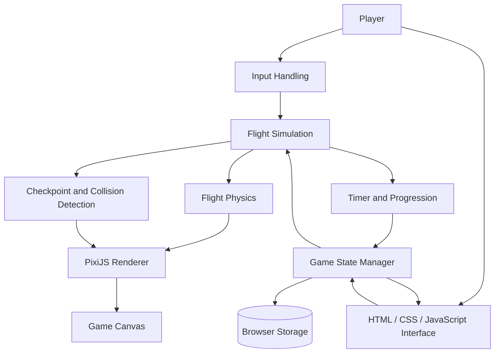
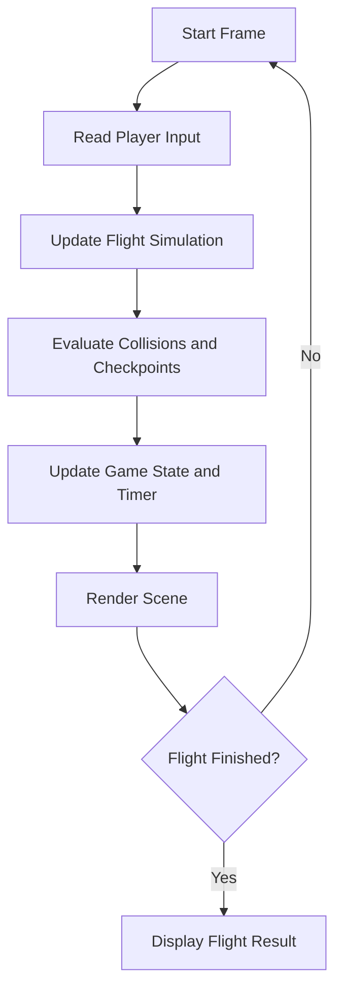
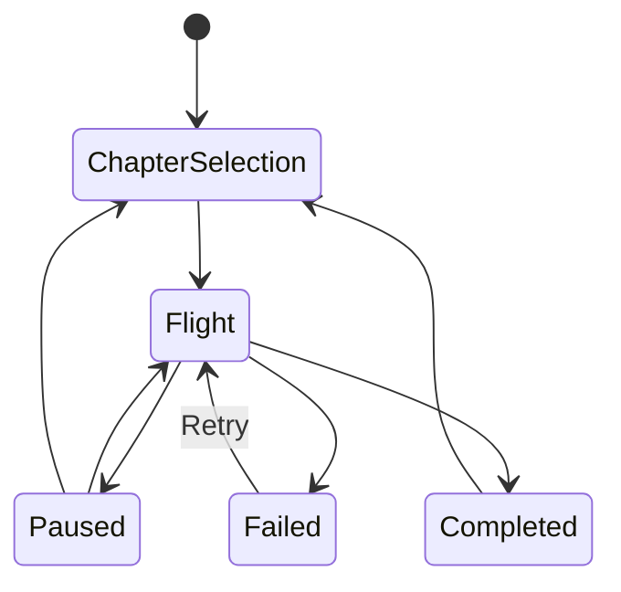
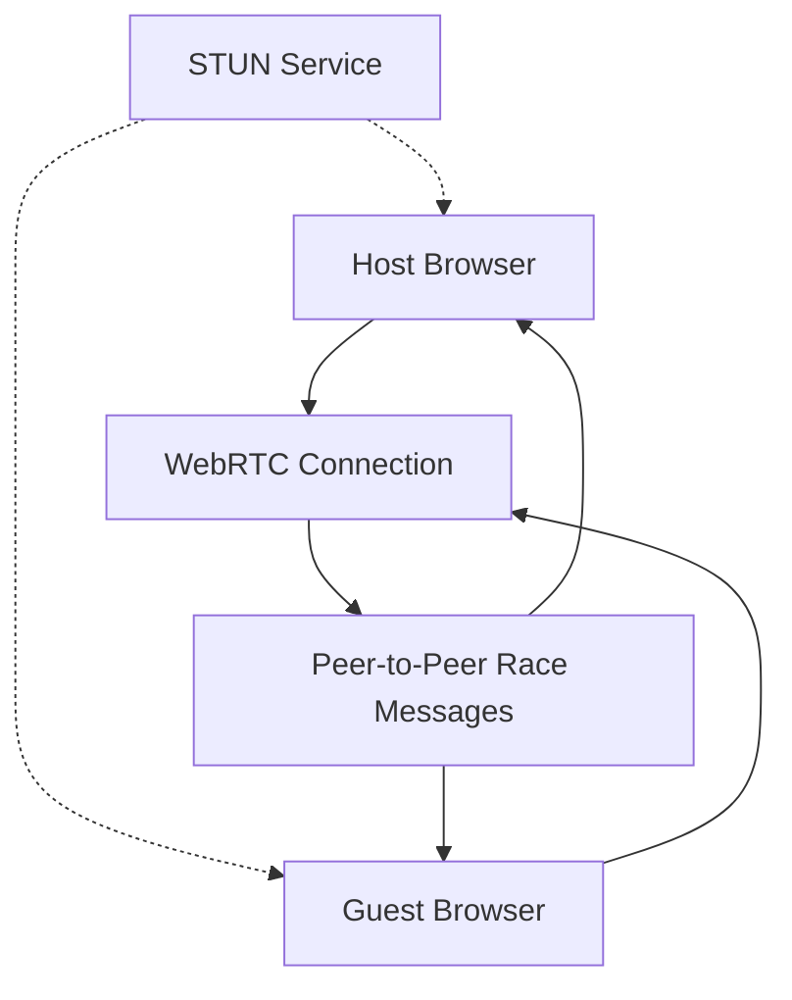

# Paperly · Paper Plane Adventure

[](https://github.com/9harshithp/Paperly/actions/workflows/ci.yml)


A standalone PixiJS 8.23.0 browser-based flight game developed as a game engineering practice project.

The project explores real-time rendering, flight simulation, collision detection, chapter progression, browser-based persistence and peer-to-peer multiplayer.

## Features

- 15 chapter routes.
- Story and Endless game modes.
- Two-player private races.
- 11 selectable paper planes and seven skins.
- Flight physics and momentum.
- Checkpoint and obstacle detection.
- Boost mechanics and collectible rewards.
- Aircraft selection and customization.
- Chapter unlocking and progression.
- Local flight history and personal records.
- Keyboard and touchscreen controls.
- Responsive game interface.
- Synthesized sound effects.
- Browser-based progress persistence.

---

## Technology Stack

<div align="center">


</div>

| Layer | Technology |
|---|---|
| Graphics rendering | PixiJS 8.23.0 |
| Game simulation | JavaScript |
| User interface | HTML5, CSS3, JavaScript |
| Multiplayer | WebRTC |
| Persistence | Browser storage |
| Audio | Synthesized sound effects |
| Runtime | Node.js 20+ |
| Unit testing | Node.js test suite |
| Browser testing | Playwright |
| Continuous integration | GitHub Actions |

---

## Game Architecture

Paperly uses PixiJS v8 for rendering, JavaScript-based flight simulation and a browser-based interface for game navigation.



### Game Loop



### Game State Transitions



### Multiplayer Architecture



Private races use WebRTC for peer-to-peer communication. Invitation and answer codes establish the connection between players. Some networks require a TURN relay.

### Engineering Design

| Design decision | Purpose |
|---|---|
| PixiJS v8 | Real-time graphics rendering |
| Fixed-step simulation | Consistent simulation updates |
| Flight physics | Aircraft movement, momentum and steering |
| Game loop | Continuous simulation and rendering |
| Collision detection | Checkpoint and obstacle interactions |
| Chapter configuration | Data-driven environment management |
| Game state management | Flight, pause and completion states |
| Browser storage | Persistent local player progression |
| WebRTC | Peer-to-peer private racing |
| Modular JavaScript | Separation of simulation, rendering and interface logic |
| Playwright | Automated browser smoke testing |

---

## Repository Structure

| File | Responsibility |
|---|---|
| `dist/js/data.js` | Chapter configuration, terrain, aircraft attributes, prices and skins |
| `dist/js/sim.js` | Fixed-step flight simulation, collisions, momentum, boost and scoring |
| `dist/js/world.js` | Perspective projection, terrain rendering, aircraft and pickups |
| `dist/js/main.js` | Menus, input handling, pause, results and progression |
| `dist/js/race.js` | WebRTC connection and private race messages |
| `dist/js/sound.js` | Synthesized wind and pickup sounds |
| `dist/style.css` | Game styling and responsive interface |
| `dist/index.html` | Application entry point |
| `tools/landscapes.py` | Optional panorama generation using Python, NumPy and Pillow |

---

## Run Locally

### Prerequisites

- Node.js 20 or newer.
- Modern browser with WebGL support.

### 1. Clone the Repository

```bash
git clone https://github.com/9harshithp/Paperly.git
cd Paperly
```

### 2. Start the Application

```bash
npm start
```

### 3. Open the Game

http://localhost:8080

The project bundles PixiJS, fonts and artwork.

For static hosting, deploy the contents of `dist/` at the website root.

---

## Game Controls

| Input | Action |
|---|---|
| Space | Launch flight |
| W / Up Arrow | Climb |
| S / Down Arrow | Dive |
| A / Left Arrow | Steer left |
| D / Right Arrow | Steer right |
| Shift | Boost |
| Escape | Pause solo flight |

Touchscreen players can choose joystick or directional controls in Settings.

## Game Modes

| Mode | Description |
|---|---|
| Story | Chapter-based flight progression |
| Endless | Extended flight through available environments |
| Private Race | Two-player peer-to-peer racing |

## Player Progression

The browser stores player-specific information, including:

- Quantum balance.
- Unlocked aircraft.
- Equipped aircraft and skins.
- Completed chapters.
- Personal best records.
- Flight history.
- Achievement progression.
- Game settings.

Progress is specific to the browser and website origin.

---

## Private Multiplayer Races

1. Both players open the application.
2. Select Private Race.
3. Exchange the invitation and answer codes.
4. The host selects the chapter.
5. Launch the race.

Private races support two tabs in the same browser through a local channel. Direct play across separate networks requires a viable WebRTC connection.

A hosted matchmaking service and TURN relay credentials are outside the current implementation.

---

## Testing and Continuous Integration

### Unit Tests

```bash
npm test
```

Simulation coverage includes:

- Flight movement and momentum.
- Chapter completion.
- Collision outcomes.
- Checkpoint interactions.
- Pickups and boost.
- Endless flight behavior.

### Browser Smoke Tests

```bash
npm run test:e2e
```

### Current Testing Status

| Check | Reported result |
|---|---|
| Playwright smoke tests | 4/4 passed locally |
| Simulation unit tests | 9/10 passed during local debugging |
| GitHub Actions CI | Configured |
| Timed chapter simulation test | Under investigation |

The latest reported CI run failed on a timed chapter simulation test. CI remediation is currently on hold.

[View GitHub Actions workflow](https://github.com/9harshithp/Paperly/actions)

---

## Development Roadmap

- [x] PixiJS rendering
- [x] Flight simulation
- [x] Chapter progression
- [x] Aircraft selection
- [x] Browser-based persistence
- [x] Private multiplayer prototype
- [x] Playwright smoke tests
- [x] GitHub Actions configuration
- [ ] Resolve remaining simulation test failure
- [ ] Multiplayer reliability improvements
- [ ] Public deployment

---

## References and Attribution

This independent educational project draws inspiration from Paperly: Paper Plane Adventure.

- [CrazyGames browser listing](https://www.crazygames.com/game/paperly-paper-plane-adventure)
- [Developer press kit](https://abhitechgames.com/paperlypresskit/)
- [Public gameplay guide](https://www.bubbleshooter.net/game/paperly-paper-plane-adventure/)

The original Paperly game belongs to its respective creators.

This repository is an educational implementation for exploring game development concepts. PixiJS and font license notices are included alongside the bundled files.

---

## Contributing

Suggestions, bug reports and technical improvements are welcome through GitHub issues and pull requests.

---

## Developer

<div align="center">

### Harshith P

Backend Engineer | Full Stack Developer | Game Development

[](https://github.com/9harshithp)
[](https://www.linkedin.com/in/harshithp914)
[](https://portfolio-bay-three-10.vercel.app/)
[](mailto:harshithp914@gmail.com)

</div>
